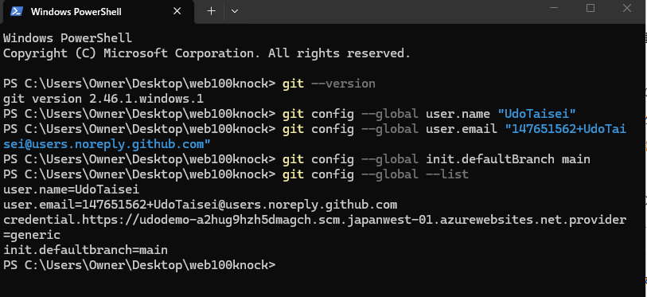
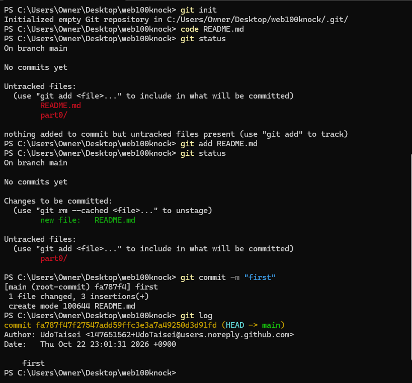

# part0

## 00
### Gitのインストール

## 01
### リポジトリの初期化と最初のコミット

## 02
### アカウントの作成
省略

## 03
### 連携

PS C:\Users\Owner\Desktop\web100knock> git remote add origin git@github.com:UdoTaisei/web100knock.git  
PS C:\Users\Owner\Desktop\web100knock> git remote -v  
origin  git@github.com:UdoTaisei/web100knock.git (fetch)  
origin  git@github.com:UdoTaisei/web100knock.git (push)  

## 04
### ファイルの変更
GitHubで編集
